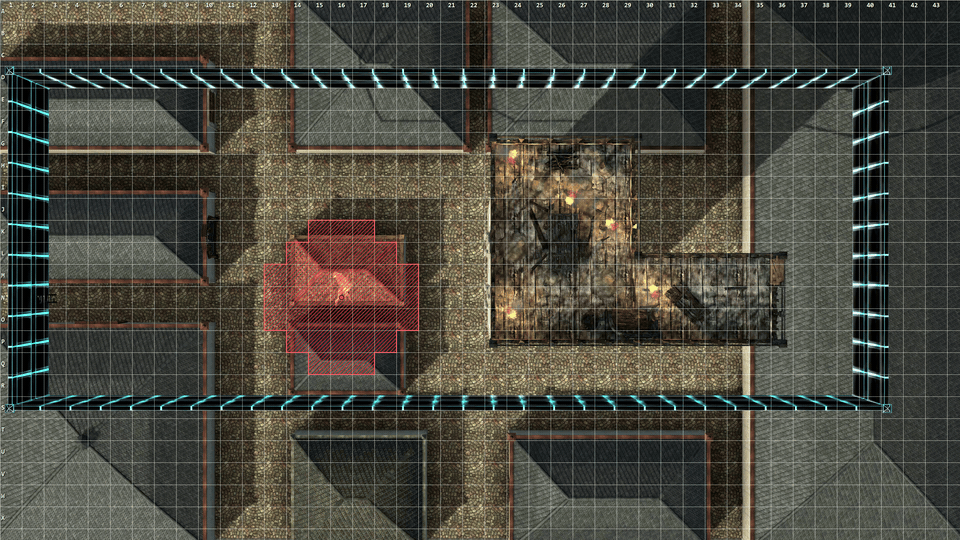
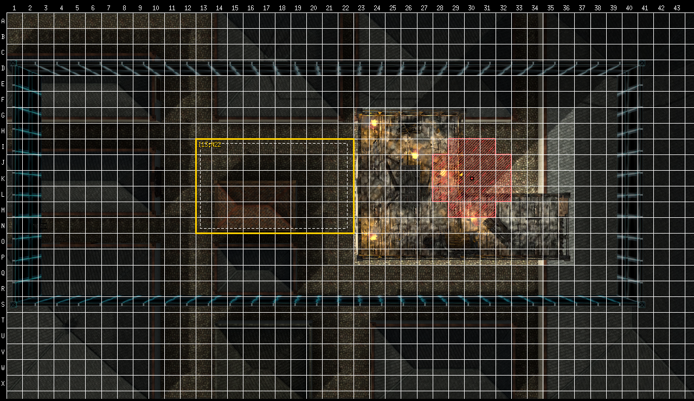

# Battlemap

The battlemap feature turns a screen, typically a TV lying flat under glass, into a battle map for physical miniatures. It shows a backdrop (a still image or a looping video), draws a grid whose cells are exactly one inch on the physical screen, labels cells with coordinates, and places sprites and areas of effect on the grid. A scaled copy of the map can be opened on the game master's own screen.



Everything is controlled with `map` commands. `map help` lists them in the shell; the [command reference](#command-reference) below has the same list with examples.

## Calibration

The grid is defined in physical inches, not in pixels. The pixel density of the screen is derived from its physical diagonal and the resolution of the monitor the window is on:

```toml
[features.battlemap]
window = "battlemap"
screen_diagonal_in = 50     # physical diagonal of the table screen, in inches
cell_size_in = 1.0          # one grid cell, in inches
# pixels_per_inch = 88.1    # override if the measured grid is off
grid_color = "#ffffff"
grid_width = 1
coords_style = "letters"    # letters (E8) | numbers (5,8)
coords_location = "sides"   # sides | cells
# coords_color = "#ffffff"  # defaults to grid_color
aoe_hatching = true         # hatch lines inside areas of effect (false: outline only)
```

A 50" 4K TV works out to about 88.1 pixels per inch, giving a grid of roughly 44 by 25 one-inch cells. `map grid` prints the values in use and where they came from, which makes it easy to check the result with a ruler. If the measured cells are off, `pixels_per_inch` overrides the calculation.

The grid always covers the whole window, starting at the top-left corner, so the right and bottom edges usually end in partial cells. `map grid resize <percent>` changes the cell size relative to the calibrated size for the rest of the session (100 restores it); it is never written back to the configuration.

### Preparing maps

The backdrop is stretched to fill the window, so the map's own grid lines up with the drawn grid only if the map is made for the screen. For the 50" 4K TV above, that means a map with a 16:9 aspect ratio of roughly 44 by 25 squares. A map exported with a different aspect ratio is stretched slightly, and a different number of squares makes the map's grid drift from the drawn grid towards the right and bottom edges.

## Coordinates

Cells are numbered from the top-left, starting at 1, and are always written **row first**:

| Style | Row 5, column 8 | Rows | Columns |
|---|---|---|---|
| `letters` (default) | `E8` | A, B, C, ... Z, AA, AB, ... | 1, 2, 3, ... |
| `numbers` | `5,8` | 1, 2, 3, ... | 1, 2, 3, ... |

Rows get the letters because the screen is wider than it is tall: at one-inch cells a 4K TV has 25 rows (A to Y) and 44 columns, so the letters never need to double up.

Commands accept both styles at any time, in upper or lower case; output always uses the active style. A range of cells is written as two opposite corners separated by a colon: `B3:C5` (or `2,3:3,5`), in any order.

For areas of effect, an origin can also be the top-left corner of a cell, the grid intersection, by adding `c`: `E8c` or `5,8c`.

## Backdrops

`map show <file>` loads an image or a video from `assets/images` and shows the battlemap window. `map bgclear` removes the backdrop and leaves the grid, sprites and areas of effect in place.

Images in any format Pillow can read are supported. They are scaled to fill the window.

### Animated backdrops

`.webm` files are played as looping animated backdrops. Frames are decoded on a background thread and streamed to the screen, so memory use does not depend on the length of the video. Playback is capped at 15 frames per second and pauses while the window is hidden.

The limiting factor is the time Tk needs to put a full-screen frame on the display: about 35 ms per 4K frame. That rules out 4K at 30 frames per second but leaves comfortable headroom at 15. Videos exported by tools such as Dungeon Alchemist are often much larger than 4K and run at 30 frames per second; the largest ones cannot even be decoded in real time. `map show` warns about such files and prints the command to convert them once with [FFmpeg](https://ffmpeg.org/):

```
ffmpeg -i "in.webm" -vf "fps=15,scale=3840:2160:flags=lanczos" -an -c:v libvpx-vp9 -crf 32 -b:v 0 -row-mt 1 -deadline good -cpu-used 4 "out_4k15.webm"
```

The converted file is usually much smaller as well. A 440 MB, 13500x7500 export became a 56 MB file in under a minute.

## Grid and coordinate labels

`map grid on` and `map grid off` show and hide the grid lines. The coordinate labels are independent of the lines, which is useful for maps that already have a grid printed on them, but they follow the same cell size.

`map coords on` shows the labels in one of two places:

- `sides`: column numbers along the top edge and row labels along the left edge, inside the first row and column.
- `cells`: the full coordinate in the top-left corner of every cell, where a miniature standing in the middle does not cover it.

Labels get a dark shadow so they stay readable on light and dark maps. The font scales with the cell size, and labels are hidden when cells become too small to hold them; a smaller `map grid resize` can hide the in-cell labels while the side labels remain.

## Sprites

A sprite is an image placed on the grid: a piece of furniture, a door, a token, an effect. Sprites are taken from `assets/images` like backdrops.

```
map sprite add chest.png E8                 a sprite in one cell, named sprite1
map sprite add rug.png B3:C5 as rug         a sprite covering a range of cells
```

### Footprints

A sprite's location and size are the same thing: its **footprint**, the cell or range of cells it covers. The image is scaled to fit inside the footprint with its proportions kept, and centred. To make a sprite bigger, its footprint is changed:

```
map sprite resize rug B3:D6      the rug now covers 4 rows and 4 columns
map sprite move rug F10          the top-left corner moves to F10; the size stays
```

`move` takes a single cell and never changes the size. `resize` takes the complete new range and may also shift the sprite.

### Rotation

`map sprite rotate <name> <degrees>` rotates clockwise, relative to the current rotation; negative values rotate counter-clockwise. The rotated image is fitted into the footprint, so a long sprite rotated by 90 degrees shrinks until it fits its old footprint. Resizing the footprint afterwards (for example from `B3:B5` to `B3:D3`) restores the full size.

### Animated sprites

Animated GIF, APNG and animated WebP files play in place. All animated sprites share one clock with the video backdrop, sprites using the same file stay in sync, and an animation keeps its timing when the grid is resized. All frames of an animated sprite are kept in memory at display size; when that exceeds 400 MB, a warning is printed, but the sprite is still shown.

### Names

Sprites without a name are called `sprite1`, `sprite2` and so on. Numbers are never reused, so a name always refers to the same sprite for the rest of the session. Custom names given with `as` may contain letters, digits, `_` and `-`, and must be unique (case-insensitive). `map sprite list` shows all sprites with their footprints.

Sprites stay on the grid when the backdrop changes. `map sprite clear` removes all of them at once.

### Hidden sprites

A hidden sprite is on the map for the game master but not for the players, for traps, secret doors or a monster lying in wait. Adding `hidden` at the end of `map sprite add` places one:

```
map sprite add spikes.png E8 as pit hidden     on the mirror only
map sprite reveal pit                          now on the table screen as well
map sprite hide pit                            hidden again
map sprite reveal all                          every hidden sprite at once
```

The table screen does not draw hidden sprites at all. The [game master mirror](#game-master-mirror) shows them at half opacity with a thick purple outline, so a sprite the game master can see is never mistaken for one the players can see. Revealing or hiding a sprite changes nothing else about it: its name, footprint, rotation and place in the drawing order stay the same. `map sprite list` marks hidden sprites and counts them.

Hidden sprites and the [fog of war](#fog-of-war) are independent. Revealing fog does not reveal a hidden sprite in it, and a revealed sprite under the fog stays covered on the table screen until its cells are revealed too; the report mentions this. `… as hidden` on its own names a sprite "hidden"; only a final `hidden` after the cells or the name hides it.

## Areas of effect

Areas of effect are drawn as hatched cells with an outline and a dot at the origin. Each one gets its own colour, so overlapping areas remain distinguishable. `map aoe hatch off` leaves out the hatch lines on the table screen, so areas are drawn as outlines with their origin dot only; `map aoe hatch on` brings them back, and `map aoe hatch` on its own prints the current setting. The default comes from `aoe_hatching` in the configuration. Hatching costs a little drawing time on every frame of a video backdrop, so turning it off can help with very large areas. All sizes are in feet and must be multiples of 5; one cell is 5 feet. Diagonal distance follows the 5-10-5 rule: the first diagonal step costs 5 feet, the second 10, the third 5, and so on.

Every shape is written in the same order, shape, origin and size, followed by extra arguments for cones:

```
map aoe sphere <origin> <radius>                       [as <name>]
map aoe cube   <corner> <size>                         [as <name>]
map aoe cone   <cell>   <length> <direction> [mirror]  [as <name>]
```

| Shape | Origin |
|---|---|
| sphere | A cell (`E8`) or a cell's top-left corner (`E8c`) |
| cube | A corner only (`E8c`): the cube's top-left corner |
| cone | A cell only (`E8`): the caster's cell |

Using the wrong kind of origin gives an error that explains the correct form.

The examples below use `O` for the origin cell and `X` for affected cells.

**Sphere from a cell**, `map aoe sphere E8 10`: every cell within 10 feet of E8, counted from cell to cell.

```
     6 7 8 9 10
C    . X X X .
D    X X X X X
E    X X O X X
F    X X X X X
G    . X X X .
```

**Sphere from a corner**, `map aoe sphere E8c 10`: measured from the point between D7, D8, E7 and E8. The four cells touching that point count as 5 feet away.

```
     6 7 8 9
C    . X X .
D    X X X X
E    X X X X
F    . X X .
```

**Cube**, `map aoe cube E8c 15`: three by three cells, extending right and down from the top-left corner of E8. The origin is a corner of the cube, not its centre.

```
     8 9 10
E    X X X
F    X X X
G    X X X
```

**Cone along a row or column**, `map aoe cone E8 15 e`: starts next to the caster and widens by one cell per step. Steps with an even width cannot be centred and lean down (east and west cones) or right (north and south cones); `mirror` makes them lean the other way.

```
     8 9 10 11              with mirror:   8 9 10 11
D    . . .  X                          D   . . X  X
E    O X X  X                          E   O X X  X
F    . . X  X                          F   . . .  X
```

**Diagonal cone**, `map aoe cone E8 15 se`: every cell within range in the quarter ahead of the caster. `mirror` does not apply to diagonal cones.

```
     8 9 10 11
E    O . .  .
F    . X X  X
G    . X X  .
H    . X .  .
```

Directions are `n`, `ne`, `e`, `se`, `s`, `sw`, `w` and `nw`, with north at the top of the screen.

`map aoe move <name> <origin>` moves an area to a new origin. The origin follows the same rules as when the area was created; a sphere may switch between a cell and a corner origin. To change the shape, size or direction, the area is removed and created again.

## Fog of war

`map fow on` covers the whole map in solid black. Parts of it are uncovered with `map fow reveal`, using the same cells and ranges as sprites, and covered again with `map fow hide`:

```
map fow on
map fow reveal B2:E8       the room the party is in
map fow reveal F3:G5       the corridor ahead
map fow hide C3            a door closes
map fow off                everything visible again
```

Reveals add up, and `map fow` on its own prints whether fog is on and how many cells are revealed. `map fow off` removes the fog and forgets all reveals, so the next `map fow on` starts with the whole map hidden again.

The fog hides the backdrop and the sprites under it, which allows traps, treasure or monsters to be placed in advance; they appear when their cells are revealed. Areas of effect, the grid and the coordinate labels are drawn on top of the fog and stay visible. Loading a different backdrop with `map show` keeps the fog on or off as it was; when it is on, the new map starts fully hidden.

The fog is opaque because Tk canvases do not support transparency; on the [game master mirror](#game-master-mirror) it is drawn see-through instead. Reveals are stored in cells, like sprites, so they follow `map grid resize`; the backdrop does not change with the grid, so after a resize a revealed area no longer covers exactly the same part of the map image.

## Game master mirror

`map mirror show` opens the mirror: a second window with a scaled copy of the battlemap, meant for the game master's own screen. It shows the same backdrop, sprites, areas of effect and fog of war as the table screen, on the same cells. At most one mirror is open at a time; `map mirror show` while it is open brings it to the front.



The mirror opens where the battlemap window first appeared when the program started, at the same size. On Windows that position is chosen by Windows, usually on the primary display, before the battlemap window is moved to the table screen. `map mirror remove` closes the mirror, and so does its close button; closing it releases the memory it uses, and the next `map mirror show` opens it at the starting position again. `map mirror` on its own prints the size of the window, the size of the map inside it and the cell size.

The mirror is a copy of the table window, not a second calibrated screen. The table's map is scaled down uniformly to fit the mirror window, and black bars fill the remaining space, so the mirror always shows the same cells as the table, including the partial cells at the right and bottom edges. It follows the table when the table changes, for example after `map fullscreen` or `map grid resize`. Resizing the mirror window only changes how large the copy is drawn.

The mirror differs from the table screen in five ways:

- **Its own grid, coordinates and AoE hatching.** `map mirror grid on|off`, `map mirror coords on|off` and `map mirror aoe hatch on|off` control the mirror only; the grid and coordinates are on when it opens, and the hatching follows `aoe_hatching` in the configuration. `map grid on|off`, `map coords on|off|location` and `map aoe hatch on|off` control the table only. The coordinate style (`map coords style`) applies to both.
- **Rulers instead of labels.** Coordinates are shown as rulers outside the map: column numbers above it and row labels to its left. Their font size is fixed and follows the display scaling, so they stay readable however small the cells are. When a cell is too small for its label, the rulers label every 2nd, 5th, 10th, ... cell.
- **See-through fog.** Hidden cells are darkened rather than black, so the game master sees what is under the fog, including sprites placed in hidden areas. Tk canvas shapes cannot be transparent, but images can, so the mirror's fog is drawn as one semi-transparent image.
- **Hidden sprites.** Sprites hidden from the players are shown faded with a thick purple outline; see [hidden sprites](#hidden-sprites).
- **Stills instead of animation.** A `.webm` backdrop is shown as a still image of its first frame, so the video is not decoded a second time, and animated sprites show their first frame too: the mirror is for seeing what is where, and every animation frame would cost memory and repaints.

The display settings never change the battlemap itself. `map mirror grid` and `map mirror coords` only change what the mirror shows, the cell size always comes from the table, and resizing or closing the mirror leaves the table screen untouched. The only way the mirror changes the map is mouse input, described below, and that goes through the normal commands.

### Mouse input

Every `map` command that takes a cell, a range, a sprite or an area of effect has a mirror version that takes it from the mouse instead. Typing the command without that part puts the mirror in a **mode**; clicks, drags and the mouse wheel on the mirror then supply it. The mirror turns the result into the same command the game master would otherwise type, and runs it:

```
map mirror fow reveal          then drag over the room on the mirror
[mirror] map fow reveal B2:E8  printed in the console, followed by the usual report
```

Because the result is an ordinary command, the same checks apply as when typing it, the table screen and the mirror update together, and the console shows every change the mouse made. Typed commands and mouse commands run one after the other, in the order they arrive; see [the core documentation](../../core/README.md#threading).

| Command | With the mouse | Runs |
|---|---|---|
| `map mirror fow reveal` / `hide` | Click a cell or drag over cells | `map fow reveal` / `hide <cells>` |
| `map mirror sprite add <file> [as <name>] [hidden]` | Click a cell or drag over a range | `map sprite add <file> <cells> [as <name>] [hidden]` |
| `map mirror sprite remove` | Click a sprite | `map sprite remove <name>` |
| `map mirror sprite move` | Click a sprite, then click where it goes; or drag it there | `map sprite move <name> <cell>` |
| `map mirror sprite rotate [step]` | Click a sprite, turn the wheel, click | `map sprite rotate <name> <degrees>` |
| `map mirror sprite resize` | Click a sprite, then drag its new footprint | `map sprite resize <name> <range>` |
| `map mirror sprite reveal` | Click a hidden sprite | `map sprite reveal <name>` |
| `map mirror sprite hide` | Click a visible sprite | `map sprite hide <name>` |
| `map mirror aoe sphere <radius> [as <name>]` | Move the preview, click | `map aoe sphere <origin> <radius> [as <name>]` |
| `map mirror aoe cube <size> [as <name>]` | Move the preview, click | `map aoe cube <corner> <size> [as <name>]` |
| `map mirror aoe cone <length> [as <name>]` | Move the preview, turn the wheel to aim it, click | `map aoe cone <cell> <length> <direction> [mirror] [as <name>]` |
| `map mirror aoe remove` | Click an area of effect | `map aoe remove <name>` |
| `map mirror aoe move` | Click an area, then click where it goes; or drag it there | `map aoe move <name> <origin>` |

A mode stays on until it is left, so several cells, sprites or areas can be handled in a row. The exception is a command with `as <name>`: a name can be used only once, so that mode ends after one sprite or area. Without a name, every click adds another one (`sprite1`, `sprite2`, ..., `aoe1`, ...).

A mode command opens the mirror if it is not open yet. Everything that can be checked before the mouse is used is checked straight away: `map mirror fow reveal` is refused while the fog is off; sprite and area commands report a missing file, a size that is not a multiple of 5, an invalid rotation step, or a name that is invalid or already taken; and the commands that pick a sprite or an area are refused when there is none.

**Previews.** The mirror shows what a click will do before it happens. Previews are drawn on the mirror; the T key can show some of them on the table screen as well (see below).

- Cells: the cell under the pointer is outlined, and while dragging the mirror outlines the cells that will be selected and shows their range.
- Sprites: a see-through copy of the sprite shows where it will be drawn, fitted into its cells exactly as on the map, also while moving, rotating or resizing. A rotation preview darkens the original underneath, so the turned copy stands out.
- Areas of effect: a see-through preview of the affected cells follows the pointer, with the origin dot and a label such as `20 ft sphere H15c`. A new area is previewed in yellow, since its colour is only chosen when it is created; a moved area keeps its own colour.
- Picking: before a click, the sprite or area it would pick is outlined with its name, in red when the mode removes it.

**Showing a preview on the table.** While a mode that places, moves, rotates or resizes a sprite or an area of effect is on, pressing T on the mirror also shows its preview on the table screen, for example to let the players see where a fireball would land before it is placed. Pressing T again shows it on the mirror only. The console mentions T when such a mode starts, the mirror's title says when the preview is shown on the table, and it is off again whenever a mode starts.

The table shows only the result: the see-through sprite where it will be drawn, or the outline and origin dot of the area, without a fill or labels. Highlights of what a click would pick or remove, the hovered cell and all labels stay on the mirror. T does nothing in the fog modes, so what is about to be revealed remains the game master's decision. Sprite previews on the table respect the fog of war: like the sprites themselves, they are drawn below it, so moving a sprite under the fog does not give it away. The preview of a [hidden sprite](#hidden-sprites) never goes to the table at all: T does nothing while placing one, and while one is picked up for moving, rotating or resizing its preview stays on the mirror, which the console mentions. The table preview disappears when the mouse leaves the mirror's map and when the mode ends.

**Selecting cells.** The cell where the mouse button is pressed always counts, wherever in it the drag starts. From there, a drag adds each further column of which at least half the width lies inside the dragged rectangle, and each further row of which at least half the height does, so the far edge snaps to the nearest grid line. The result is always a rectangle of cells, the same kind of range as `B2:E8`. A drag that leaves the map stops at its edge, and a short drag inside one cell selects just that cell.

**Picking sprites and areas.** A sprite is picked by clicking any cell of its footprint, an area of effect by clicking any of its cells, not by the exact shape of the image. Where several overlap, the topmost is picked: the one added last, which is also drawn on top. `map mirror sprite reveal` only considers hidden sprites and `map mirror sprite hide` only visible ones, so a visible chair on top of a hidden trap does not get in the way. Sprites under the fog of war, and hidden sprites, can be picked on the mirror, where they are visible.

**Moving.** A picked sprite or area can be put down with a second click, or dragged and released. It hangs from the pointer by the point where it was picked, so it does not jump. A sprite stays on the cells that are fully visible on the table screen. An area keeps its shape, size, direction and colour, and its new origin follows the same rules as when it is created (below).

**Origins of areas of effect.** A sphere is centred on a grid corner (`E8c`) when the pointer is within a quarter of a cell of one, and on the cell's centre (`E8`) otherwise; the origin dot shows which. A cube starts at the grid corner nearest to the pointer, which becomes its top-left corner. A cone starts from the cell under the pointer, the caster's cell.

**The mouse wheel.** When rotating a sprite, each notch turns it by the step given to the command, 15° by default; turning the wheel down rotates clockwise. The label shows the total, and the rotation is applied the short way round. When aiming a cone, each notch down steps clockwise through all twelve variants: n, n mirrored, ne, e, e mirrored, se, s, s mirrored, sw, w, w mirrored, nw. A touchpad works too: its small scroll steps add up to whole notches.

**Leaving a mode.** A mode ends with Esc, a right-click on the mirror, another mode command, closing the mirror, or when the mirror loses focus, for example by clicking in the console to type the next command. While a sprite or area is picked up (moving, rotating or resizing), the first Esc or right-click only puts it back; the next one ends the mode. The console prints why a mode ended. While a mode is on, the mouse pointer over the map is a crosshair and the mirror's title names the mode, such as `battlemap_mirror — revealing fog (Esc to stop)`.

**Focus.** Opening the mirror and starting a mode bring the mirror to the front with keyboard focus, so Esc works straight away. Afterwards, the console has to be clicked before typing the next command. If the operating system refuses to hand over the focus, the first click on the mirror gives it focus instead; losing focus only ends a mode after the mirror has had it.

## Command reference

| Command | Description |
|---|---|
| `map show <file>` | Load an image or `.webm` video from `assets/images` and show the window |
| `map bgclear` | Remove the backdrop |
| `map fullscreen` | Borderless fullscreen on the monitor the window is on |
| `map restore` | Default window size; also brings the window back after it was closed |
| `map grid` | Grid status and calibration |
| `map grid on` / `off` | Show or hide the grid lines |
| `map grid resize <percent>` | Cell size as a percentage of the calibrated size (10 to 1000) |
| `map coords` | Coordinate label status |
| `map coords on` / `off` | Show or hide coordinate labels |
| `map coords style letters` / `numbers` | Notation for labels and output |
| `map coords location sides` / `cells` | Where the labels are drawn |
| `map sprite add <file> <cell or range> [as <name>] [hidden]` | Place a sprite; `hidden` keeps it off the table screen |
| `map sprite move <name> <cell>` | Move a sprite's top-left corner, keeping its size |
| `map sprite resize <name> <range>` | Set a sprite's footprint |
| `map sprite rotate <name> <degrees>` | Rotate clockwise by the given angle |
| `map sprite remove <name>` | Remove one sprite |
| `map sprite list` | List all sprites |
| `map sprite clear` | Remove all sprites |
| `map sprite reveal <name>` / `all` | Show a hidden sprite on the table screen, or all of them |
| `map sprite hide <name>` | Hide a sprite from the table screen |
| `map aoe sphere <origin> <radius> [as <name>]` | Spherical area |
| `map aoe cube <corner> <size> [as <name>]` | Cubic area |
| `map aoe cone <cell> <length> <direction> [mirror] [as <name>]` | Cone |
| `map aoe move <name> <origin>` | Move an area to a new origin |
| `map aoe remove <name>` | Remove one area |
| `map aoe list` | List all areas |
| `map aoe clear` | Remove all areas |
| `map aoe hatch`, `map aoe hatch on` / `off` | Show the setting; hatch lines inside the areas on the table screen, or outlines only |
| `map fow` | Fog of war status |
| `map fow on` / `off` | Hide the whole map / remove the fog (and forget reveals) |
| `map fow reveal <cell or range>` / `hide <cell or range>` | Uncover or cover part of the map |
| `map mirror` | Mirror status |
| `map mirror show` | Open the game master mirror, or bring it to the front |
| `map mirror remove` | Close the mirror (same as its close button) |
| `map mirror grid on` / `off` | Show or hide the mirror's grid lines |
| `map mirror coords on` / `off` | Show or hide the mirror's coordinate rulers |
| `map mirror aoe hatch on` / `off` | Hatch lines inside the areas on the mirror, or outlines only |
| `map mirror fow reveal` / `hide` | Reveal or hide fog by clicking or dragging on the mirror |
| `map mirror sprite add <file> [as <name>] [hidden]` | Place sprites by clicking or dragging on the mirror; `hidden` keeps them off the table screen |
| `map mirror sprite remove` | Remove sprites by clicking them on the mirror |
| `map mirror sprite move` | Move sprites on the mirror (click-click or drag) |
| `map mirror sprite rotate [step]` | Rotate sprites with the mouse wheel on the mirror (default step 15°) |
| `map mirror sprite resize` | Resize sprites by dragging their new footprint on the mirror |
| `map mirror sprite reveal` | Reveal hidden sprites by clicking them on the mirror |
| `map mirror sprite hide` | Hide sprites by clicking them on the mirror |
| `map mirror aoe sphere <radius> [as <name>]` | Place spheres with a live preview on the mirror |
| `map mirror aoe cube <size> [as <name>]` | Place cubes with a live preview on the mirror |
| `map mirror aoe cone <length> [as <name>]` | Place cones on the mirror, aimed with the mouse wheel |
| `map mirror aoe remove` | Remove areas of effect by clicking them on the mirror |
| `map mirror aoe move` | Move areas of effect on the mirror (click-click or drag) |

## How it is drawn

Everything is drawn on a single Tk canvas in layers, from bottom to top: backdrop, sprites, fog of war, areas of effect, grid, coordinate labels. Grid lines and labels therefore stay visible on top of everything, areas are drawn over sprites and fog, and the fog hides the backdrop and sprites. On the mirror, the previews of mouse input are drawn on one more layer above all of these, which stays on top when the map underneath is redrawn. Previews shown on the table with T sit with what they preview instead: sprite previews just above the sprites and below the fog, area previews just above the areas of effect.

Only the backdrop is expensive to redraw: scaling a 4K image takes noticeable time and memory. Changes to the other layers never cause the backdrop to be redrawn, and a video backdrop reuses one image for every frame.

The shared state (backdrop, cell scale, coordinate style, sprites, areas of effect and fog of war) lives in `BattleMapState`. What a particular window shows, such as whether the grid or labels are visible and where the labels go, belongs to the view. The table screen and the [mirror](#game-master-mirror) are two views of the same state, which keeps them consistent; the mirror's view derives its cell size from the table's view and reads the state without changing it. Mouse input on the mirror changes the state only by running ordinary commands. Both views share the decoded backdrop image, so the mirror does not hold a second full-resolution copy.

## Files

| File | Contents |
|---|---|
| `__init__.py` | The feature: `map` commands, reports, grid calibration and tab completion |
| `model/battlemap_state.py` | Shared state: backdrop, cell scale, coordinate style, sprites, areas of effect, fog of war |
| `model/grid.py` | Calibration, cell geometry, coordinate parsing and labels, cell ranges, mirror scaling, rulers and the cells a drag selects |
| `model/aoe.py` | Area of effect command parsing and the cells each shape covers |
| `sprite_images.py` | Reading, rotating and scaling sprite images and animation frames |
| `video.py` | Streaming `.webm` decoder running on a background thread |
| `views/battlemap_view.py` | The canvas and its layers |
| `views/mirror.py` | The game master mirror: the scaled copy of the table view and its rulers |
| `views/mirror_input.py` | Mouse input on the mirror: running a mode, focus, the mouse wheel, ending modes and drawing previews |
| `views/mirror_tools.py` | What the mouse does in each mode: selecting cells, picking, moving, rotating and resizing sprites, placing, moving and removing areas of effect |
| `views/animation.py` | The shared animation clock, the video backdrop and sprite animations |
| `styling.py` | Colours used by the view |

The modules under `model/`, `sprite_images.py` and `video.py` do not use Tk, which keeps the geometry and parsing testable without a display.
